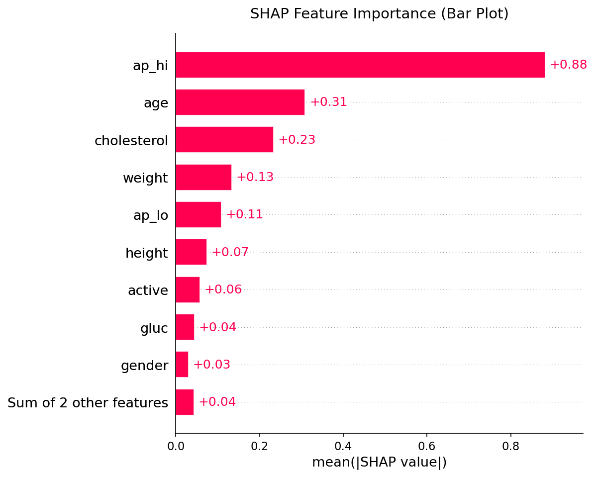
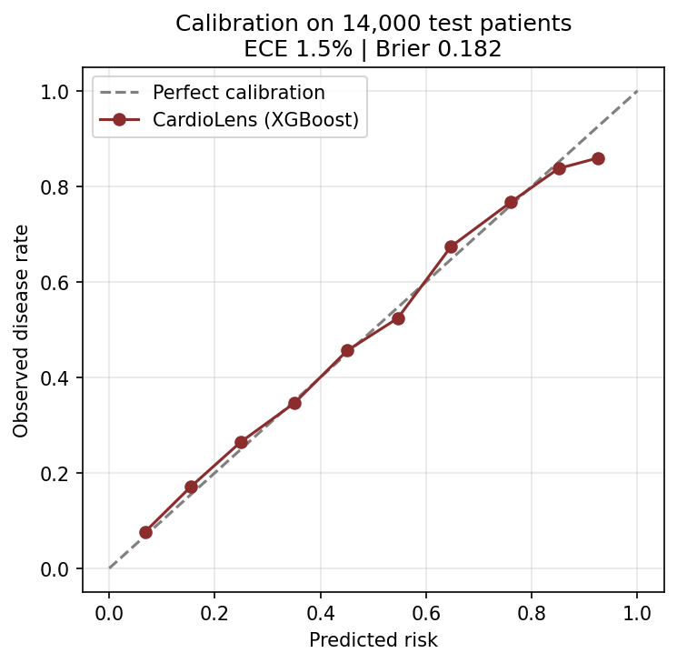

# CardioLens AI

[](https://github.com/arwin-tech/cardiolens-ai/actions/workflows/ci.yml)

**Explainable cardiovascular disease risk prediction**

CardioLens AI predicts a person's risk of cardiovascular disease from 11 basic health details, like age, blood pressure, cholesterol and smoking, and shows which factors raised or lowered that risk.

**Live demo:** [cardiolens-ai.vercel.app](https://cardiolens-ai.vercel.app) · **API docs:** [cardiolens-ai-za8w.onrender.com/docs](https://cardiolens-ai-za8w.onrender.com/docs)

> [!IMPORTANT]
> This is a research and learning project, not a medical tool. Do not use it to diagnose or treat anyone.

The backend runs on Render's free tier, which sleeps when idle, so the first request can take up to a minute. The app shows a "waking up" message while it starts, and one-click example patients let you try it straight away.

## Features

- **Risk prediction:** enter patient details to get a risk percentage, a risk level (Low, Moderate, Elevated or High) and BMI
- **Factor breakdown:** exact SHAP values for each patient (TreeSHAP, computed by XGBoost), showing which factors pushed their risk up or down
- **Calibrated range:** every prediction also shows how often held-out patients with similar scores actually had heart disease (Venn–Abers, a conformal prediction method)
- **Suggested changes:** the smallest sets of healthier changes (one, two or three) that lower the predicted risk, never touching age, sex, height or medication
- **Two models:** the original clinic model and a US population model trained on CDC survey data, with medication as an input
- **What-if simulator:** change the blood pressure and see how the risk changes
- **Report download:** save a plain-text summary of the assessment
- **Batch scoring:** upload a CSV of up to 5,000 patients and get a risk score for each. Every row is checked with the same rules as the form, and rows that fail are skipped with the reason
- **Live monitoring:** a dashboard of usage, response times, risk mix and input drift that stores only aggregate counts, never patient data

## How It Works

The model is an XGBoost classifier trained on 70,000 patient records from the Kaggle Cardiovascular Disease dataset. It beat Logistic Regression and Random Forest, and on 14,000 test patients it reaches **73.2% accuracy** and a **ROC-AUC of 0.798**.

SHAP analysis shows that systolic blood pressure is by far the biggest factor in the model's predictions, followed by age and cholesterol.

<p align="center">
  
</p>

## Calibration

The risk percentages are well calibrated. On the 14,000 test patients, the expected calibration error is 1.5% and the Brier score is 0.182, so a predicted 30% risk means roughly 30% of similar patients had the disease. The one weak spot is the very top: patients predicted at around 92% had an 85% disease rate, so very high scores are best read as "high" rather than exact.

Platt scaling was tested on a held-out half of the test set and only reduced the calibration error from 1.8% to 1.2%, so it isn't deployed. To reproduce: `python src/evaluate_calibration.py`.

<p align="center">
  
</p>

## Fairness Check

Does the model work equally well for everyone? On the same 14,000 test patients:

| Group | Patients | ROC-AUC | Recall at the 50% cut-off | Calibration error |
|---|---|---|---|---|
| Women | 9,080 | 0.793 | 68.6% | 1.6% |
| Men | 4,920 | 0.806 | 71.1% | 1.4% |
| Under 45 | 2,033 | 0.837 | 57.4% | 1.7% |
| 45–49 | 1,793 | 0.786 | 61.1% | 3.8% |
| 50–54 | 3,732 | 0.786 | 60.9% | 1.9% |
| 55–59 | 3,254 | 0.750 | 67.5% | 1.5% |
| 60 and over | 3,188 | 0.715 | 85.2% | 2.5% |

Women and men get almost identical performance. Age is where the model differs: the risk percentages stay well calibrated in every age band, but at the app's 50% cut-off it catches 57% of disease cases in patients under 45 versus 85% in patients 60 and over, because younger patients get lower scores overall. Separating sick from healthy patients also gets harder with age (ROC-AUC 0.84 down to 0.72). A real screening tool would need to choose its cut-off for the population it serves; this demo keeps 50%. To reproduce: `python src/fairness_check.py`.

## External Validation

To see whether the model works outside its training data, it was tested, unchanged, on 2,916 US adults aged 30–65 from NHANES 2013–2014, the US national health survey run by the CDC (public domain). The 11 inputs were mapped from NHANES measurements, and "heart disease" means a doctor had diagnosed coronary heart disease, angina, a heart attack, heart failure or a stroke (6.9% of the group).

| Measure | Result on NHANES |
|---|---|
| ROC-AUC | 0.631 (95% CI 0.595–0.666), down from 0.798 on the training data's test set |
| Ranking by age alone | ROC-AUC 0.696, better than the model |
| Calibration as deployed | average predicted risk 39.0%, actual rate 6.9% (calibration error 32.1%) |
| After recalibrating on half the data | calibration error 1.8% on the other half |

The model does not transfer well to this population: ranking people by age alone works better. Its percentages are far too high because half the training patients had heart disease; refitting the scale on local data fixes that, but not the ranking. The main reason is blood pressure, the model's strongest input. On its own it separates sick from healthy far better in the training data (ROC-AUC 0.75) than in NHANES (0.55), partly because 66% of NHANES participants with heart disease take blood-pressure or cholesterol medication, which lowers those readings. Even among people not on medication the model doesn't beat age alone, so differences in population and in how heart disease is defined matter too. The model should not be used outside populations like its training data without retraining. To reproduce: `python src/external_validation.py` (downloads the NHANES files from CDC, about 15 MB).

## Uncertainty Ranges

Each prediction comes with a calibrated range from inductive Venn–Abers predictors, part of the conformal prediction family. For a score, isotonic regression is fitted on held-out calibration patients twice (once as if the patient had the disease, once as if not), and the two results bracket the calibrated probability. In plain terms: how often patients with similar scores actually had heart disease.

The ranges were calibrated on 7,000 of the held-out test patients and checked on the other 7,000. They are usually narrow (median width 0.3 percentage points, 90% within 1.3) but widen to 13.71 points for unusual scores, which is the point: they show when the model has seen few similar patients. The model was already well calibrated (calibration error 1.8%, essentially unchanged at 1.8% with Venn–Abers), and the ranges make its slight overconfidence at the top end visible: a 91.3% score corresponds to an observed rate of about 86%. Reproduce with `python src/build_model_artifacts.py`.

## Suggested Changes (Counterfactuals)

For each patient, the API tries every combination of realistic, healthier changes to what a person can change (blood pressure in 10 mmHg steps down to 110, weight loss of 5 or 10 kg without going below a BMI of 22, quitting smoking or regular drinking, becoming active, lower cholesterol and glucose levels), scores them all in one batch, and returns the best plan using one, two and three changes. Age, sex, height and medication never change. This exposes a quirk of the clinic model: smokers in the Kaggle data have slightly lower recorded disease rates, so it rarely credits quitting. The suggestions describe the model's behaviour, not proven medical effects.

## US Population Model

<!-- nhanes-model:start -->
Not trained yet. Run `python src/train_nhanes_model.py` to download five NHANES surveys from CDC, train on 2009–2016 and test on 2017–2020; this section then fills in automatically.
<!-- nhanes-model:end -->

## Monitoring Without Patient Data

The `/monitoring` page shows predictions per day, response times, the risk mix and input drift (population stability index against each model's training data). Only daily counts in coarse buckets are stored, never inputs, exact values, times or IP addresses. Any count under 5 is hidden and drift waits for 30 predictions, so a quiet day can't reveal one person's inputs. Counts live in memory by default; set `DATABASE_URL` to a Postgres connection string (for example a free Supabase or Neon database) to keep them across restarts.

## SQL Data Layer

The `sql/` folder rebuilds the data preparation in SQL with DuckDB: a data-quality profile (it flags 1,321 physiologically impossible blood-pressure readings), cleaning and feature engineering, and disease rates by age band and blood-pressure category. The deployed model is unchanged. To run it: `pip install duckdb`, then `python train_from_sql.py`.

## Tech Stack

- **ML:** Python, XGBoost, scikit-learn, SHAP, SQL (DuckDB)
- **Backend:** FastAPI, SQLAlchemy (optional Postgres for monitoring), hosted on Render
- **Frontend:** React, TypeScript, Vite, Tailwind CSS, Recharts, hosted on Vercel
- **Engineering:** pytest (35 API tests), GitHub Actions CI on every push, Docker image for the API

## Run Locally

You need Python 3.10+ and Node.js 18+.

**1. Start the backend**

```bash
git clone https://github.com/arwin-tech/cardiolens-ai.git
cd cardiolens-ai
pip install -r backend/requirements.txt
cd backend
uvicorn main:app --reload
```

The API runs at http://127.0.0.1:8000, with docs at http://127.0.0.1:8000/docs.

**2. Start the frontend** (in a new terminal, from the project folder)

```bash
cd frontend
cp .env.example .env      # Windows: copy .env.example .env
npm install
npm run dev
```

Then open http://localhost:5173.

**Or run the API with Docker**

```bash
docker build -t cardiolens-api backend
docker run -p 8000:8000 cardiolens-api
```

**Run the tests**

```bash
pip install -r backend/requirements.txt -r backend/requirements-dev.txt
python -m pytest backend -v
```

## Project Structure

```text
backend/          FastAPI server and the trained model
frontend/         React web app
src/              Training and explainability scripts
data/             Dataset
explainability/   SHAP charts
sql/              Data profiling and feature engineering in SQL (DuckDB)
```
